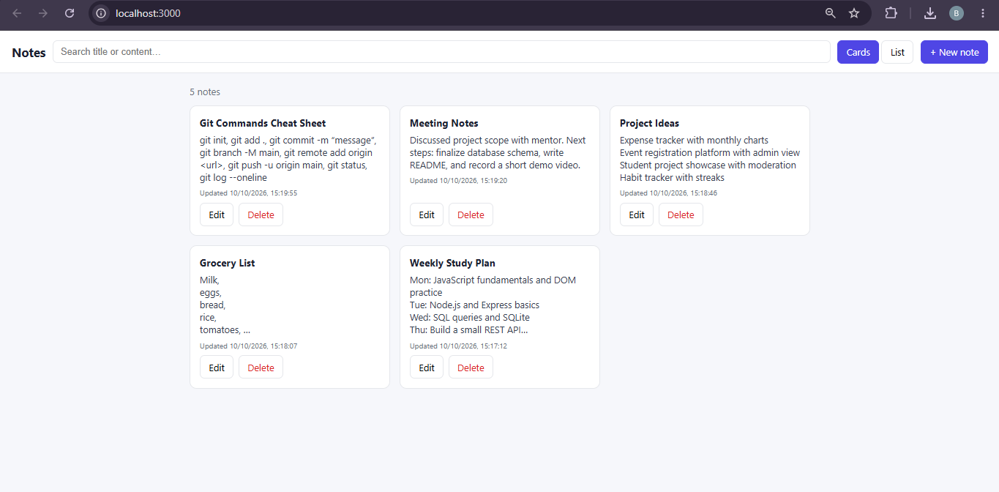
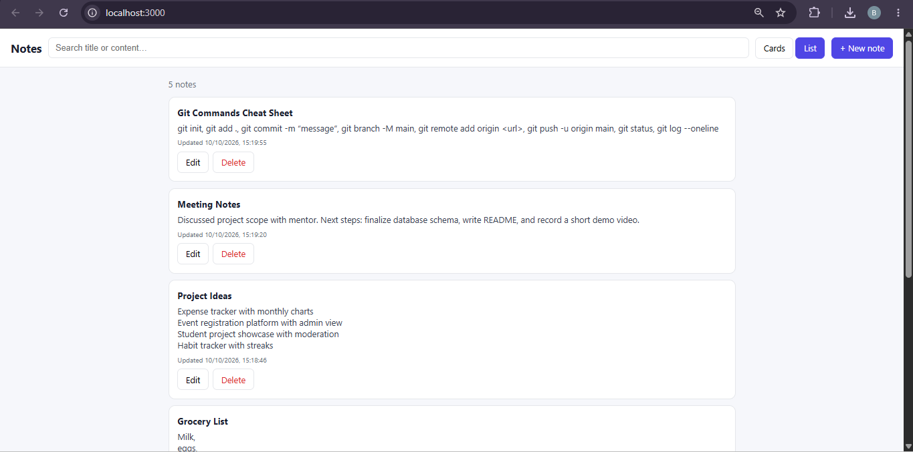
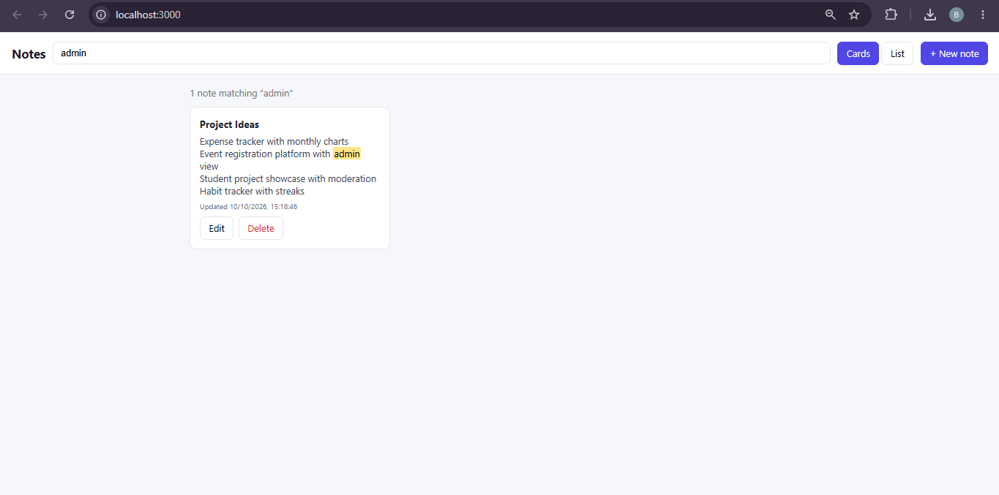
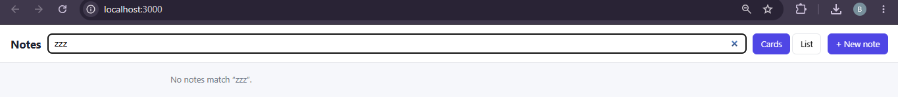

# Notes Application

A full-stack notes app (CodeNova Internship, Batch 01, Full Stack Development, Task 1). Create, edit, search, and delete notes through a REST API backed by SQLite.

## Features

- Create, view, edit, and delete notes
- Instant search across title and content (debounced, with match highlighting)
- Responsive card grid or list view
- Toast notifications for success, network failures, and server errors
- UI always re-fetches from the API after changes, so it matches the database
- Input validation on the server (title required, max 120 characters)

## Tech stack

| Layer    | Technology                        |
|----------|-----------------------------------|
| Frontend | Vanilla HTML, CSS, JavaScript     |
| Backend  | Node.js, Express                  |
| Database | SQLite via `better-sqlite3`       |

All free and local. No paid services or API keys.

## Project structure

```
notes-app/
├── client/            # Static frontend (served by Express)
│   ├── index.html
│   ├── style.css
│   └── app.js
├── server/            # REST API + database
│   ├── index.js       # Express routes
│   ├── db.js          # SQLite connection, runs schema.sql on startup
│   ├── schema.sql     # Database schema
│   └── package.json
└── README.md
```

## Setup

Requires Node.js 18+.

```bash
cd server
npm install
npm start
```

Open http://localhost:3000. The database file (`server/notes.db`) and table are created automatically on first run from `schema.sql`.

Optional environment variables: `PORT` (default 3000), `DB_PATH` (default `server/notes.db`).

## Database schema

```sql
CREATE TABLE notes (
  id         INTEGER PRIMARY KEY AUTOINCREMENT,
  title      TEXT NOT NULL CHECK (length(title) BETWEEN 1 AND 120),
  content    TEXT NOT NULL DEFAULT '',
  created_at TEXT NOT NULL DEFAULT (datetime('now')),
  updated_at TEXT NOT NULL DEFAULT (datetime('now'))
);
```

## API

| Method | Endpoint          | Description                                   |
|--------|-------------------|-----------------------------------------------|
| GET    | `/api/notes`      | List notes, newest first. Optional `?q=` search on title and content |
| GET    | `/api/notes/:id`  | Get one note                                  |
| POST   | `/api/notes`      | Create a note. Body: `{ "title", "content" }` |
| PUT    | `/api/notes/:id`  | Update a note                                 |
| DELETE | `/api/notes/:id`  | Delete a note (204)                           |

Errors return JSON like `{ "error": "Title is required." }` with status 400, 404, or 500.

## Architecture

The browser talks only to `/api/notes`. The Express server validates input and runs parameterized SQL queries (no string-built SQL), then returns JSON. The client wraps every request in one helper that turns network failures and error responses into toast messages. Client and server concerns live in separate folders.

## Screenshots

### Card view
Responsive grid of note cards with Edit and Delete actions.



### List view
Same data in a single-column list layout.



### Search with highlighting
Results filter instantly by title and content, and the matching text is highlighted.



### Empty search state
A friendly message appears when nothing matches the search.



## License

MIT
