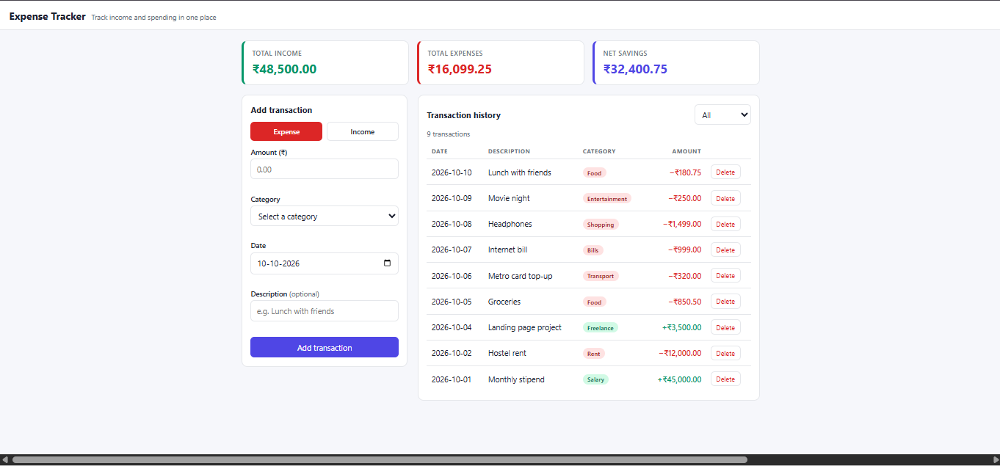
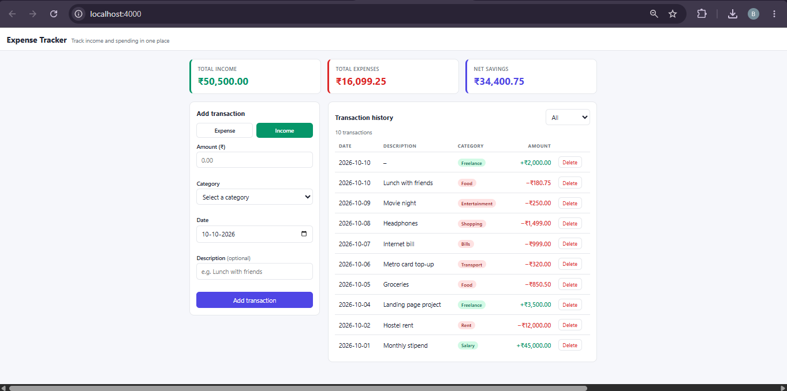
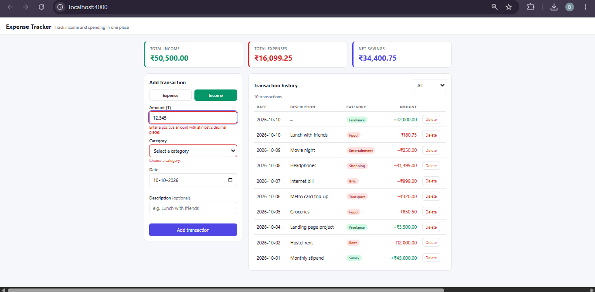
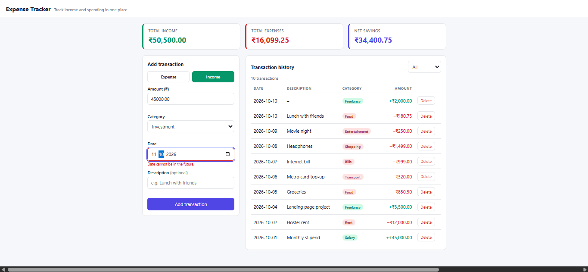

# Expense Tracker

A full-stack expense tracker (CodeNova Internship, Batch 01, Full Stack Development, Task 2). Log income and expenses, see live balance totals, browse a transaction history, and keep everything in a persistent SQLite database.

## Features

- Transaction form with **client-side and server-side validation** (the server re-checks everything, so invalid data is rejected even if the UI is bypassed)
- Balance cards for **total income, total expenses and net savings**, calculated by the database with SQL `SUM`
- Transaction history table with **category badges**, a type filter and a delete action
- **Persistent storage**: data lives in a SQLite file and survives server restarts
- Fully responsive: the table turns into stacked cards on phones
- Toast notifications for success, validation errors, network failures and server errors

## Tech stack

| Layer    | Technology                    |
|----------|-------------------------------|
| Frontend | Vanilla HTML, CSS, JavaScript |
| Backend  | Node.js, Express              |
| Database | SQLite via `better-sqlite3`   |

Everything is free and local. No paid APIs, hosting or services.

## Project structure

```
expense-tracker/
├── client/              # Static frontend (served by Express)
│   ├── index.html
│   ├── style.css
│   └── app.js
├── server/
│   ├── index.js         # Express routes
│   ├── db.js            # SQLite connection, runs schema.sql on startup
│   ├── schema.sql       # Database schema
│   ├── categories.js    # Allowed categories (single source of truth)
│   ├── validate.js      # Server-side validation rules
│   ├── validate.test.js # Unit tests for the validation rules
│   ├── seed.js          # Optional sample data
│   └── package.json
└── README.md
```

## Setup and start commands

Requires Node.js 18+ (Node 20+ recommended).

```bash
cd server
npm install
npm start
```

Open **http://localhost:4000**.

The Express server serves both the API (`/api/...`) and the frontend files from `client/`, so this one command starts the backend and the frontend together. The database file (`server/expenses.db`) is created automatically on first run.

Optional commands (run inside `server/`):

```bash
npm run seed    # add sample transactions for demos and screenshots
npm test        # run the validation unit tests
npm run dev     # restart automatically when server files change
```

Environment variables (all optional): `PORT` (default 4000), `DB_PATH` (default `server/expenses.db`).

## Database model

One table, `transactions`:

| Column         | Type    | Rules                                              |
|----------------|---------|----------------------------------------------------|
| `id`           | INTEGER | Primary key, auto-increment                        |
| `type`         | TEXT    | `income` or `expense` (CHECK constraint)           |
| `amount_cents` | INTEGER | Must be greater than 0 (CHECK constraint)          |
| `category`     | TEXT    | Must belong to the chosen type (validated by API)  |
| `description`  | TEXT    | Optional, up to 200 characters                     |
| `date`         | TEXT    | `YYYY-MM-DD`                                       |
| `created_at`   | TEXT    | Defaults to the current UTC time                   |

**Why cents?** Money is stored as whole cents (`₹250.50` becomes `25050`). Integer math has no rounding errors, so the dashboard totals match the database exactly.

Categories:
- **Income:** Salary, Freelance, Gift, Investment, Other Income
- **Expense:** Food, Transport, Rent, Bills, Shopping, Entertainment, Health, Education, Other

## API contract

Base URL: `http://localhost:4000/api`. All bodies are JSON.

| Method | Endpoint                 | Description                                              | Success |
|--------|--------------------------|----------------------------------------------------------|---------|
| GET    | `/categories`            | Allowed categories per type                              | 200     |
| GET    | `/transactions`          | List transactions, newest first. Optional `?type=income` or `?type=expense` | 200 |
| POST   | `/transactions`          | Create a transaction (validated)                         | 201     |
| DELETE | `/transactions/:id`      | Delete a transaction                                     | 204     |
| GET    | `/summary`               | Totals across all transactions                           | 200     |

### POST /transactions

Request:
```json
{
  "type": "expense",
  "amount": "250.50",
  "category": "Food",
  "date": "2026-10-09",
  "description": "Lunch"
}
```

`amount` may be a string or number: positive, at most 2 decimal places. `description` is optional.

Response `201`:
```json
{
  "id": 7,
  "type": "expense",
  "amount": 250.5,
  "amount_cents": 25050,
  "category": "Food",
  "description": "Lunch",
  "date": "2026-10-09",
  "created_at": "2026-10-10 09:30:00"
}
```

### GET /summary

```json
{ "income_cents": 4850000, "expense_cents": 1599925, "net_cents": 3250075, "count": 9 }
```

The summary always covers every transaction, regardless of the filter chosen in the UI.

### Validation rules (enforced by the server)

| Field         | Rule                                                                 |
|---------------|----------------------------------------------------------------------|
| `type`        | Must be `income` or `expense`                                        |
| `amount`      | Greater than 0, at most 2 decimals, no letters, negatives or exponents, below 1,000,000,000 |
| `category`    | Must be a valid category for the chosen type                         |
| `date`        | A real calendar date (`2026-02-31` is rejected), from 2000-01-01, not in the future |
| `description` | Optional text, up to 200 characters                                  |

Invalid requests return `400` with every problem listed at once:
```json
{
  "error": "Validation failed.",
  "errors": {
    "amount": "Enter a positive amount with at most 2 decimal places.",
    "date": "Enter a valid date (YYYY-MM-DD)."
  }
}
```

Other errors use the shape `{ "error": "message" }`: `400` for a bad id or malformed JSON, `404` for an unknown transaction or route, `500` for unexpected server errors.

### Try the validation yourself

```bash
curl -X POST http://localhost:4000/api/transactions \
  -H "Content-Type: application/json" \
  -d '{"type":"expense","amount":"-5","category":"Food","date":"2026-02-31"}'
```

## Architecture

The browser only talks to `/api`. Every number on screen (balance cards and table rows) is fetched from the server after each change, so the UI always mirrors the database. The summary is computed with SQL `SUM`, never added up in the browser. Validation lives in one server module (`validate.js`) with unit tests, and the client runs a matching set of checks only to give faster feedback.

## Screenshots

**Dashboard:** balance cards, transaction form and history table



**Adding income**



**Validation errors:** the form and the server reject invalid input



**Date validation:** future dates are not allowed


## demo

https://github.com/user-attachments/assets/2158fcaa-6503-4ffa-9871-c8c56e76aec6


## License

MIT

[Back to all projects](../README.md)
